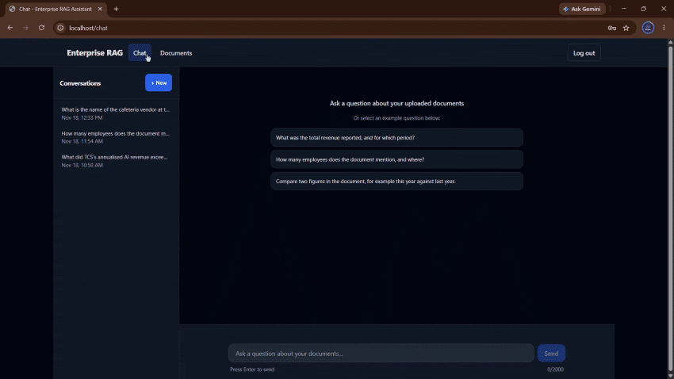

# Enterprise RAG Assistant

## 1. Problem Statement & Architecture

Enterprise knowledge discovery across heterogeneous corporate documentation (such as financial annual reports, PDFs, DOCX files, and tabular CSVs) is frequently impaired by LLM hallucinations, lost context, and ungrounded generation. The Enterprise RAG Assistant provides an end-to-end question-answering system designed for verifiable corporate document search. It parses source files into token-bounded, structure-aware chunks, executes dense semantic retrieval, and orchestrates an agentic reasoning cycle featuring query planning, iterative retrieval retries, and claim-level fact-checking against the retrieved passages, to yield grounded answers with page-level citations and a short excerpt, or an explicit refusal when evidence is insufficient.

### System Architecture

```text
+-----------------------------------------------------------------------------------+
|                                  Client Browser                                   |
+-----------------------------------------------------------------------------------+
                                          |
                                          | HTTP (Port 80)
                                          v
+-----------------------------------------------------------------------------------+
|                        Frontend Service (Docker / Nginx)                          |
|  - Serves compiled React SPA static assets                                        |
|  - Overwrites X-Forwarded-For with $remote_addr (single trusted proxy)            |
|  - Reverse-proxies API routes (/auth, /chat, /sessions, /documents, /feedback,    |
|    /health, /docs, /redoc, /openapi.json) to the API service (internal port 8000) |
|  - Blocks /metrics (404); metrics are internal to the stack                       |
+-----------------------------------------------------------------------------------+
                                          |
                                          | Internal HTTP (Port 8000)
                                          v
+-----------------------------------------------------------------------------------+
|                         API Service (FastAPI / Uvicorn)                           |
|                                                                                   |
|  +-----------------------------------------------------------------------------+  |
|  |                             FastAPI Web Layer                               |  |
|  |  - Auth, Sessions, Documents, Chat, Streaming (SSE), Feedback, Health,      |  |
|  |    Prometheus metrics                                                       |  |
|  +-----------------------------------------------------------------------------+  |
|                                         |                                         |
|  +-----------------------------------------------------------------------------+  |
|  |                        Agent Orchestrator & Logic                           |  |
|  |  - Planner, retriever, drafter and fact-checker with bounded retries        |  |
|  |  - Fact-checker & citation verification against retrieved passages          |  |
|  |  - OpenRouter client with retries                                           |  |
|  +-----------------------------------------------------------------------------+  |
|                                         |                                         |
|  +-----------------------------------------------------------------------------+  |
|  |                     Embedded Chroma Vector Store (In-Process)               |  |
|  |  - Persisted at /app/data/chroma (chroma_data volume)                       |  |
|  |  - BAAI/bge-small-en-v1.5 embeddings (no standalone vector DB server)       |  |
|  |  - Dense semantic search is the base retriever                              |  |
|  |  - Optional: BM25 keyword fusion (off by default), cross-encoder reranker   |  |
|  +-----------------------------------------------------------------------------+  |
+-----------------------------------------------------------------------------------+
        |                                   |                               |
        | SQL / asyncpg                     | redis-py                      | HTTPS
        v                                   v                               v
+-----------------------+       +-----------------------+       +-------------------+
|      PostgreSQL       |       |         Redis         |       |    OpenRouter     |
|   (postgres:5432)     |       |     (redis:6379)      |       |  External LLM API |
| - Users & Auth        |       | - Rate Limiter State  |       | (nemotron models) |
| - Chat Sessions       |       | - Health-check ping   |       +-------------------+
| - Messages & Exchanges|       +-----------------------+
| - Document Metadata   |
| - Audit Logs          |
+-----------------------+
```

*(Note: The system runs entirely within these services. There is no separate asynchronous worker service and no external vector database server; Chroma runs embedded directly within the API process).*

Detailed documentation of the ingestion module: [docs/ingestion-module.md](docs/ingestion-module.md)

---

## 2. Results

### Setup

The assistant was evaluated on 34 frozen golden questions about one document (the TCS annual report PDF): 25 answerable and 9 unanswerable. The golden file’s SHA-256 (9f78d9b8…) matched three recorded copies and did not change. All answers came from one model, nvidia/nemotron-3-ultra-550b-a55b:free (not stored per record; same model according to the operator).

Variants:
- **single_draft**: one search, one draft, no planner, no retries, no fact-check.
- **full_agent**: plan, retrieve, draft, fact-check, with retries.
- **agent_no_checker**: replayed on all 34 questions from the cache (0 live requests).

Grading rubric (app/eval/grading_rules.md): CORRECT, ROUNDED, PARTIAL, WRONG_FIGURE, REFUSED_ANSWERABLE and UNSUPPORTED_EXTRA for answerable questions; REFUSED_GOOD and ANSWERED_BAD for unanswerable ones. Answers were graded against the reference answers and the PDF, with AI assistance (see provenance).

### Results (34 questions)

| Grade | full_agent | single_draft | agent_no_checker |
|---|:---:|:---:|:---:|
| CORRECT | 19 | 18 | 19 |
| ROUNDED | 2 | 2 | 2 |
| PARTIAL | 0 | 0 | 0 |
| WRONG_FIGURE | 0 | 0 | 0 |
| UNSUPPORTED_EXTRA | 1 | 0 | 1 |
| REFUSED_ANSWERABLE | 3 | 5 | 3 |
| REFUSED_GOOD | 9 | 9 | 9 |
| ANSWERED_BAD | 0 | 0 | 0 |

The agent_no_checker column equals full_agent because all 34 answers were identical; its 25 newer grades are mechanical copies.

### Subset without repeated tuning facts (n=21)

Four golden questions (gold-04, gold-14, gold-16, gold-21) repeat a fact that was used while tuning the system, so they are excluded here. The overlap is recorded in app/eval/golden_tuned_overlap.json, and the retrieval evaluation already excludes them (25 − 4 = 21). Results on the remaining 21 answerable questions:

| Variant | CORRECT | ROUNDED | REFUSED_ANSWERABLE |
|---|:---:|:---:|:---:|
| full_agent | 16 | 2 | 3 |
| agent_no_checker | 16 | 2 | 3 |
| single_draft | 14 | 2 | 5 |

The pattern is the same as on the full set. The overlap does not appear to drive the difference. This subset removes repeated facts but not shared source chunks, so it is not fully independent.

### Findings

**Refusals.** On the 25 answerable questions, full_agent wrongly refused 3 (12%) and single_draft 5 (20%). With n=25 and one run each, this is within noise; the variants should not be ranked. gold-05 was answered in an earlier run (different date, probably a different model version) and refused now.

**Likely causes of the 3 remaining wrong refusals.** These are hypotheses from retrieval ranks and the single-draft text. The full_agent traces were not re-read.
- **gold-05**: the single draft saw both quarterly figures but likely declined to subtract them, because the prompt forbids calculated values.
- **gold-17**: the vertical TCV table ranks 19th in dense search and 8th in hybrid search, so it was likely retrieved too late.
- **gold-33**: likely a wording mismatch on a relative period, which points to a planner problem.

**No wrong figures.** Neither variant gave a wrong figure in its substantive answers: 0 wrong figures in 42 substantive answers (22 from full_agent, 20 from single_draft). Neither variant answered an unanswerable question: 0 of 18 attempts (9 per variant) were answered. Most of the 9 unanswerable questions are cases where the report states the data is omitted, so this is the easy case. The closest ones (gold-30, gold-31) were refused too.

**Fact-checker.** Replaying without the checker changed 0 of 34 answers, so on this set the checker neither helped nor hurt. There were no wrong figures for it to catch; the one unsupported detail (gold-04) passed. That answer, one of the 22 that could reach the checker, was marked verified with an unsupported “Table 1” label. This is the pipeline’s default section label for table chunks. The model copied it, and the checker passed it because it was in the retrieved passage. The figures were right. One case is not a rate. Outside the 34 questions, one answer in the manual browser test was marked verified although it listed quarterly headcounts implying a 30,906 drop next to the “roughly 28,500” figure. “Neither helped nor hurt” applies to the 34 questions only.

**Cost.** single_draft used 1 model call per question (median 1, max 1); full_agent a median of 3 (max 5). The fact-checker added 1 call per answered question and changed 0 of 34 answers, so on this set it cost extra calls and changed nothing.

**Source inconsistency (gold-20).** The PDF text on p28 says headcount fell “roughly 28,500” over two quarters, but its table gives 30,906 to Q3. The grade is a judgment call.

### RAGAS pilot (n=8)

Faithfulness and ContextRecall, ragas 0.2.14, computed on the text of the cited chunks only. Per-question scores: app/eval/results/ragas_pilot.csv. The sample was gold-04, forced in on purpose (it is also in the tuning-overlap set), plus seven answered full_agent questions drawn with seed 2026 from outside that set: gold-06, 15, 34, 22, 23, 13 and 19. Their grades are 6 CORRECT, 1 ROUNDED (gold-13) and 1 UNSUPPORTED_EXTRA (gold-04). gold-34 shares source chunks with a tuning question.

| Sample | Faithfulness | ContextRecall |
|---|:---:|:---:|
| Mean over 8 questions | 0.97 | 1.00 |
| gold-04 | 0.75 | 1.00 |
| The other seven | 1.00 each | 1.00 each |

The judge was nvidia/nemotron-3.5-super-vl:free. It is a different model from the generator, but from the same NVIDIA Nemotron family, so independence is limited and a lenient judge is possible. gold-04 scored 0.75 on Faithfulness because the judge accepted all three figures but marked the “Table 1 on page 23” label as unsupported by the chunk text. This matches the unsupported detail found in the manual grading. On this one case, RAGAS and the pipeline’s own fact-checker disagreed because they saw different inputs: RAGAS saw only the chunk text, while the checker’s passage also carried the section label as metadata.

With one negative case and seven top scores, the pilot shows that the harness runs and that RAGAS flagged the one known flaw. It does not show that RAGAS discriminates between good and bad answers in general. ContextRecall here measures the cited chunks, not retrieval quality. No RAGAS target is claimed.

gold-04’s first run scored 0.0. That run was discarded because the judge cache did not include the judge model, so responses from an earlier judge were probably replayed (1 live request, 2 cache hits). The re-score with judge-specific caching gave 0.75.

### Grading provenance

Grades are AI-assisted, not hand graded. The first 22 full_agent grades (gold-01 to 14, 24 to 31) came from a Claude review entered by script. The other 12 full_agent grades, all 34 single_draft grades and the 9 original agent_no_checker grades were a first pass by an AI coding agent from the PDF.

The author checked all 13 non-CORRECT answerable rows and a random sample of 10 CORRECT rows (seed 2026) against the PDF, with 0 disagreements, plus spot checks on gold-04, 09, 18, 30 and 31.

A teammate also graded 4 answers blind, without seeing our grades, and agreed on 4 of 4. This is the only independent human check, and 4 answers is a small sample. Details are in app/eval/grading_log.md.

### Limits

- One document, 34 questions, one run per variant, one free-tier model, one set of AI-assisted grades.
- The independent human check covers only 4 answers.
- A RAGAS pilot (n=8, judge nvidia/nemotron-3.5-super-vl:free, same family as the generator) was run on cited chunks. It is not a full evaluation, and no RAGAS target is claimed. One judge pass per row, no variance estimate.
- The model name is not stored per record.
- A curl smoke test of the real stack used one easy question. The React interface was checked by hand (see Manual Browser Test): one user, one document.

### Retrieval Evaluation Performance

From `app/eval/results/retrieval_summary.md` (Corpus: `data/eval/documents/tcs_annual_report.pdf`, 118 chunks; Golden SHA-256: `9f78d9b82e4a7ccb2f2449cc28f45ea0a324e0c0507cb38938745ea8914bf5fc`):

#### 1. Overall Performance (All 25 Answerable Questions)

| Pipeline Variant | Recall@5 | Recall@10 | Recall@15 | Recall@20 | MRR | NDCG@10 | Avg Latency (ms) | P95 Latency (ms) |
|---|:---:|:---:|:---:|:---:|:---:|:---:|:---:|:---:|
| `retrieval_dense` | 0.6133 | 0.7200 | 0.8600 | 0.9200 | 0.5230 | 0.5552 | 23.8 | 27.8 |
| `retrieval_keyword` | 0.6667 | 0.8200 | 0.8800 | 0.8800 | 0.6088 | 0.6437 | 24.8 | 27.9 |
| `retrieval_rerank` | 0.6533 | 0.7733 | 0.9200 | 0.9200 | 0.5564 | 0.6107 | 1124.5 | 1269.6 |

#### 2. Subset Without Repeated Tuning Facts (21 Questions)

| Pipeline Variant | Recall@5 | Recall@10 | Recall@15 | Recall@20 | MRR | NDCG@10 | Avg Latency (ms) | P95 Latency (ms) |
|---|:---:|:---:|:---:|:---:|:---:|:---:|:---:|:---:|
| `retrieval_dense` | 0.5635 | 0.6667 | 0.8333 | 0.9048 | 0.4321 | 0.4871 | 23.7 | 25.7 |
| `retrieval_keyword` | 0.6349 | 0.7857 | 0.8571 | 0.8571 | 0.5343 | 0.5856 | 24.8 | 27.9 |
| `retrieval_rerank` | 0.6190 | 0.7302 | 0.9048 | 0.9048 | 0.4958 | 0.5556 | 1107.5 | 1269.6 |

`retrieval_dense` is the plain dense retriever. `retrieval_keyword` is dense search plus BM25 keyword search, fused with reciprocal rank fusion (RRF), with no reranker. `retrieval_rerank` is dense search plus the cross-encoder `cross-encoder/ms-marco-MiniLM-L-6-v2` (about 1.1 seconds per query). The keyword search is off by default in the application. Latency was measured on one machine with 118 chunks.

### Manual Browser Test

The React interface was tested by hand in a browser on a fresh clone of the repository, using the Docker quickstart below, one user, one document (the TCS annual report) and the free model. This is a manual check, not an automated test suite.

| Check | Result |
|---|---|
| Login; wrong password shows a clear message; an invalid token returns to the login page | Verified |
| Upload shows progress (reading, making it searchable, ready); a duplicate upload is rejected | Verified |
| Processing steps appear one by one; the answer shows sources and the "Found in your documents" badge | Verified |
| Blank question is not sent; an unknown conversation address returns 404 and opens a new chat | Verified |
| Busy state shows a countdown and a "Try again" button (tested with `AGENT_MAX_CONCURRENT=1`) | Verified |
| Closing the tab during an answer: the saved answer is there when the conversation is reopened | Verified |
| Rating an answer works right after it appears; a second rating replaces the first | Verified |
| An unanswerable question is refused calmly with the red "Unverified in documents" badge | Verified |
| Keyboard-only use of login, navigation, upload area, chat and rating | Verified |
| Backend stopped | Partial: the upload shows "Upload failed (HTTP 502)"; the other views show no error |

Not tested in the browser: deleting only your own files (needs a second user) and the `partially_verified` badge (covered by unit tests only).

One answer about employees repeated the "Table 1" section label and gave a "roughly 28,500" headcount decline next to quarterly closings implying 30,906 (the PDF contains both), while showing the verified badge.

---

## 3. Quickstart

**Requirements:** Docker Desktop (Compose v2), an OpenRouter API key, and about 15 GB of free disk. Tested on Windows with Docker Desktop.

**1. Clone the repository**

```bash
git clone https://github.com/Narutouzumaki-manu/enterprise-rag-assistant.git
cd enterprise-rag-assistant
```

**2. Create the environment file.** Docker reads only `docker/.env`. The `.env.example` in the repository root is for running the API outside Docker and is not used here.

```bash
# macOS / Linux / Git Bash
cp docker/.env.compose.example docker/.env
```
```powershell
# Windows PowerShell
Copy-Item docker/.env.compose.example docker/.env
```

**3. Fill in three values in `docker/.env`.** Compose refuses to start if any of them is empty.

| Variable | What to put there |
|---|---|
| `POSTGRES_PASSWORD` | A random password using letters and digits only (it is placed inside a database URL): `python -c "import secrets; print(secrets.token_hex(16))"` |
| `JWT_SECRET` | A random secret of at least 32 characters. **Replace the placeholder with a unique value**; never run with a published secret: `python -c "import secrets; print(secrets.token_urlsafe(48))"` |
| `OPENROUTER_API_KEY` | Your OpenRouter API key |

Optional: the default model is the free `nvidia/nemotron-3-ultra-550b-a55b:free`. Free models can disappear without notice. To use another model, add `OPENROUTER_MODEL=<model id>` to `docker/.env`.

`docker/.env` is git-ignored. Never commit it.

**4. Build and start**

```bash
docker compose --env-file docker/.env -f docker/docker-compose.yml up -d --build
```

The first build downloads Python packages, the embedding model and frontend dependencies, and takes several minutes. When it finishes, check that `api` shows `healthy` and `frontend` is up (the `migrate` container exits on purpose):

```bash
docker compose --env-file docker/.env -f docker/docker-compose.yml ps
```

**5. Create a user.** The command asks for a password twice (at least 8 characters).

```bash
docker compose --env-file docker/.env -f docker/docker-compose.yml exec api python scripts/create_user.py --email you@example.com
```

**6. Open the app** at http://localhost and log in with that email and password.

**7. Try it.** Open Documents, upload a PDF (the evaluation document is `data/eval/documents/tcs_annual_report.pdf`), wait for Ready, then ask a question in Chat. Port 80 must be free.

**Stop and clean up**

```bash
# stop, keep your data
docker compose --env-file docker/.env -f docker/docker-compose.yml down
# stop and delete all data (database, uploads, vector index)
docker compose --env-file docker/.env -f docker/docker-compose.yml down -v
```

---

## 4. API Reference

In the Docker setup only port 80 is published. Nginx forwards the API routes below to the API service, so every URL uses `http://localhost` with no extra prefix and no port 8000.

Interactive API documentation is available at:
- **Swagger UI**: [http://localhost/docs](http://localhost/docs)
- **ReDoc**: [http://localhost/redoc](http://localhost/redoc)
- **OpenAPI Schema**: [http://localhost/openapi.json](http://localhost/openapi.json)

### Route List

| Method | Endpoint | Description |
|---|---|---|
| `POST` | `/auth/login` | Authenticate user credentials and issue JWT bearer token |
| `POST` | `/sessions` | Create a new chat session |
| `GET` | `/sessions` | List chat sessions for the authenticated user |
| `GET` | `/sessions/{session_id}` | Retrieve specific session history and metadata |
| `POST` | `/chat` | Submit a question and receive blocking agent response |
| `POST` | `/chat/stream` | Submit a question and stream progress & answer via SSE |
| `POST` | `/documents/upload` | Upload and ingest document (PDF, DOCX, CSV) |
| `GET` | `/documents` | List all ingested documents |
| `GET` | `/documents/{document_id}` | Get metadata and status for a specific document |
| `DELETE` | `/documents/{document_id}` | Delete document record and purge vector chunks from Chroma |
| `POST` | `/feedback` | Submit quality feedback (rating/comments) on an answer |
| `GET` | `/health` | Health check endpoint (probes PostgreSQL, Redis, Agent) |

`/metrics` (Prometheus) exists inside the stack but is blocked by nginx and returns 404 from outside.

Opening `/documents`, `/chat` or `/sessions` in the browser address bar shows the app, because Nginx serves the page for browser navigation. API calls with curl reach the API.

### cURL Examples

#### 1. User Login (`/auth/login`)

```bash
curl -X POST "http://localhost/auth/login" \
  -H "Content-Type: application/json" \
  -d '{
    "email": "user@example.com",
    "password": "yourpassword"
  }'
```

*Response:*
```json
{
  "access_token": "eyJhbGciOiJIUzI1NiIsIn...",
  "token_type": "bearer",
  "expires_in": 3600
}
```

#### 2. Streaming Chat (`/chat/stream`)

First create a chat session. This call needs the Bearer token and no request body. It returns `201` with the new session in the response:

```bash
curl -X POST "http://localhost/sessions" \
  -H "Authorization: Bearer <YOUR_ACCESS_TOKEN>"
```

Copy the session id from the response and use it below.

```bash
curl -N -X POST "http://localhost/chat/stream" \
  -H "Content-Type: application/json" \
  -H "Authorization: Bearer <YOUR_ACCESS_TOKEN>" \
  -d '{
    "session_id": "<SESSION_ID_FROM_ABOVE>",
    "query": "What was TCS revenue in FY26?",
    "top_k": 8
  }'
```

---

## 5. Team and Ownership

- **Member 1, Document Ingestion** (`app/ingestion/`): Manoj S
- **Member 2, Retrieval** (`app/retrieval/`): Manoj S, Yashwanth G
- **Member 3, Agents** (`app/agents/`): Manoj S, Nitin
- **Member 4, Backend** (`app/api/`, `app/db/`): Manoj S, Prajwal
- **Member 5, Evaluation, Frontend and DevOps** (`app/eval/`, `frontend/`, `docker/`): Manoj S, Niranjan

---

## 6. Known Limitations

- no OCR, so scanned PDFs fail;
- images embedded in DOCX files are ignored;
- one shared corpus, so all signed-in users search the same documents;
- one API replica with an embedded Chroma index;
- a question takes about 36 to 175 seconds on the free model;
- when the backend is unavailable the app shows no error, except on upload ("Upload failed (HTTP 502)");
- a saved rating is not shown again after the page is reloaded (the API does not return it);
- opening an unknown conversation address silently opens a new chat, with no message;
- "verified" means supported by the retrieved passage and its metadata, not true;
- table chunks are all named "Table 1" and the model can repeat it;
- the instruction filter is a heuristic;
- grades are AI-assisted;
- one document and 34 questions;
- RAGAS was only a pilot;
- no frontend linter;
- lint baseline is ruff 75 and mypy 47.
- No HTTPS: Nginx listens on port 80 only.
- The API docs (`/docs`, `/redoc`, `/openapi.json`) are reachable through Nginx.
- Closing the browser tab does not stop a running question; the answer is still saved.
- The free model has a daily request limit.
- Tested on Windows only.
-Two moderate npm advisories in react-router-dom; the v7 upgrade is deferred. 

---

## 7. Demo


